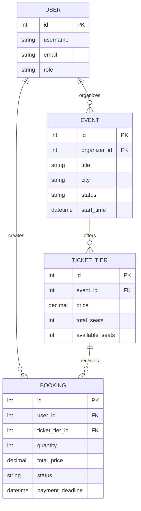

# EventHive Backend

EventHive is an event booking backend built with Django REST Framework. It supports event management, ticket reservations, payment confirmation, background jobs, caching, and AI-powered event questions.

## Tech Stack

- Python and Django
- Django REST Framework (DRF)
- PostgreSQL
- Redis
- Celery and Celery Beat
- JWT authentication
- Docker Compose
- LLM API for event-related questions

## Features

- Role-based access for organizers, attendees, and admins
- JWT authentication and token refresh/logout
- Event creation, management, approval, and rejection
- Public listing of approved events
- Ticket tiers with pricing and seat availability
- Booking creation, cancellation, and payment confirmation
- Pending booking expiration and seat restoration
- Email confirmations and scheduled event reminders
- Redis caching for public event listings
- AI-powered questions grounded in event information
- API filtering, search, ordering, and pagination
- Automated tests for booking logic and concurrency

## Prerequisites

- Python 3.12 or a compatible version used by the project
- Docker Desktop with Docker Compose
- Git

## Environment Configuration

Create your local environment file using the example:

```powershell
Copy-Item .env.example .env
```

Configure the required database, Redis, Django secret, email, and LLM settings in `.env`. Use the variable names expected by the project configuration.

Never commit `.env` or publish API keys, passwords, or Django secret keys.

## Run with Docker Compose

Build and start the services:

```powershell
docker compose up -d --build
```

Check service status:

```powershell
docker compose ps
```

Apply database migrations if the container configuration does not already run them:

```powershell
docker compose exec web python manage.py migrate
```

The Django API is available at:

`http://localhost:8000/`

Stop the services:

```powershell
docker compose down
```

## Database Design

The main entities are:

- **User:** Account identity and role.
- **Event:** Event details, organizer, schedule, location, and approval status.
- **TicketTier:** Ticket category, price, total seats, and available seats.
- **Booking:** Attendee, selected ticket tier, quantity, total price, payment deadline, and booking status.

### ER Diagram



Confirm this diagram and the listed fields against the actual models and migrations before submission.

## Booking Concurrency

Booking creation uses a database transaction and row-level locking on the ticket tier to prevent concurrent requests from reserving the same seats.

The booking flow should:

1. Start a database transaction.
2. Lock the relevant ticket tier.
3. Validate available seats and booking limits.
4. Reserve seats and create the booking atomically.
5. Roll back changes if validation or persistence fails.

The concurrency test submits 50 parallel requests against a tier with 10 seats and verifies that no more than 10 requests succeed.

## Background Tasks

Celery and Celery Beat handle background work:

- Booking confirmation email after payment confirmation
- Expiration of unpaid pending bookings
- Release of seats when bookings expire
- Reminders for eligible upcoming events

The current email backend may print messages to the console. Configure a real email provider before production deployment.

## Caching

Redis is used as the Django cache backend and Celery message broker.

Public event-list caching should be invalidated when an event is created, updated, or approved. Verify the cache key, timeout, and invalidation implementation against the source code.

## AI Event Questions

The event question endpoint is intended to answer questions using the selected event's description and FAQ.

The implementation should:

- Use only retrieved event information as factual context.
- Instruct the model to say when the answer is not present in that context.
- Handle missing API keys, provider errors, and timeouts gracefully.
- Load API credentials from environment variables.
- Avoid exposing secrets or unrelated user information.

Verify the endpoint path, request format, response format, and provider configuration against the implementation before relying on this section.

## API Documentation

If configured, API schema and Swagger UI can be accessed through the project's documentation routes. Check `config/urls.py` for the exact paths.

## Testing

Run the full test suite:

```powershell
python manage.py test
```

Run tests with coverage:

```powershell
python -m coverage run manage.py test
python -m coverage report --include="bookings/*"
```

The latest recorded run passed 30 tests, with 94% coverage for the `bookings` app. Re-run the commands after any code changes.

## Security Notes

- Keep `.env` out of version control.
- Use strong secret keys and production-safe Django settings.
- Configure trusted hosts, HTTPS, and appropriate CORS settings before deployment.
- Use a production email backend and protect API credentials.
- Review rate limiting and authorization for sensitive endpoints.

## Known Limitations

Document any remaining gaps in email delivery, reminder deduplication, payment integration, AI provider reliability, and deployment configuration before production use.
