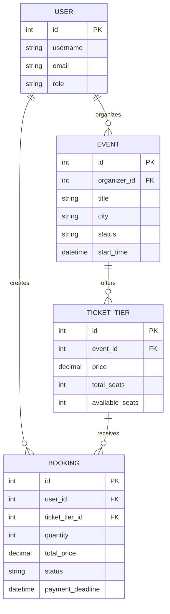

# EventHive Backend

EventHive is an event booking backend built with Django REST Framework. It supports event management, ticket reservations, payment confirmation, background jobs, Redis caching, and Gemini-powered event questions.

## Tech Stack

- Python and Django
- Django REST Framework (DRF)
- PostgreSQL
- Redis
- Celery and Celery Beat
- JWT authentication
- Docker Compose
- Google Gemini API
- drf-spectacular and Swagger UI
- pytest / Django automated tests and coverage

## Features

- Role-based access for organizers, attendees, and admins
- JWT authentication, token refresh, and logout
- Event creation, management, approval, and rejection
- Public listing of approved events
- Ticket tiers, pricing, and seat availability
- Booking creation, cancellation, and payment confirmation
- Expiration of pending bookings and seat restoration
- Confirmation emails and scheduled event reminders
- Redis caching for public event listings
- AI-powered event questions using event information
- API filtering, search, ordering, and pagination
- Automated booking, task, and concurrency tests

## Prerequisites

- Python 3.12 or the version supported by the project
- Docker Desktop with Docker Compose
- Git
- A Google Gemini API key for the AI question endpoint

## Environment Configuration

Create a local `.env` file from the example:

```powershell
Copy-Item .env.example .env
```

Configure the required variables in `.env`, including the Django secret key, database credentials, Redis settings, and Gemini API key. Use the exact variable names expected by `config/settings.py`.

Never commit `.env` or publish API keys, passwords, or Django secret keys.

## Run with Docker Compose

Build and start the services:

```powershell
docker compose up -d --build
```

Check service status:

```powershell
docker compose ps
```

Apply database migrations:

```powershell
docker compose exec web python manage.py migrate
```

The API is available at `http://localhost:8000/`.

Stop the services:

```powershell
docker compose down
```

## API Documentation

Interactive API documentation is provided by Swagger UI and drf-spectacular.

- **Swagger UI:** `http://localhost:8000/api/docs/`
- **OpenAPI schema:** `http://localhost:8000/api/schema/`

### Authentication

| Method | Endpoint | Purpose |
|---|---|---|
| POST | `/api/auth/register/` | Register a user |
| POST | `/api/auth/login/` | Obtain JWT tokens |
| POST | `/api/auth/refresh/` | Refresh an access token |
| POST | `/api/auth/logout/` | Log out |
| GET | `/api/auth/me/` | Retrieve the current user's profile |

### Events

| Method | Endpoint | Purpose |
|---|---|---|
| GET | `/api/events/` | List events |
| POST | `/api/events/` | Create an event |
| GET | `/api/events/{id}/` | Retrieve event details |
| POST | `/api/events/{id}/approval/` | Event approval action |
| GET/POST | `/api/events/{id}/tickets/` | List or create ticket tiers |
| POST | `/api/events/{id}/ask/` | Ask an AI question about an event |

### Bookings

| Method | Endpoint | Purpose |
|---|---|---|
| GET | `/api/bookings/` | List bookings |
| POST | `/api/bookings/` | Create a booking |
| POST | `/api/bookings/{id}/cancel/` | Cancel a booking |
| POST | `/api/bookings/{id}/confirm-payment/` | Confirm payment |

Check Swagger UI for supported methods, request schemas, authentication requirements, and response formats.

## Database Design

The primary entities are:

- **User:** Account identity and role.
- **Event:** Event details, organizer, schedule, location, and approval status.
- **TicketTier:** Ticket category, price, total seats, and available seats.
- **Booking:** Attendee, ticket tier, quantity, total price, payment deadline, and booking status.

### ER Diagram



Verify the diagram's fields against the actual models and migrations before submission.

## Booking Concurrency

Booking creation is designed to use database transactions and row-level locking to prevent overselling.

The intended flow is:

1. Start a database transaction.
2. Lock the relevant ticket tier.
3. Validate available seats and booking limits.
4. Reserve seats and create the booking atomically.
5. Roll back changes if validation or persistence fails.

The concurrency test submits 50 parallel requests against a ticket tier with 10 seats and verifies that no more than 10 requests succeed.

## Background Tasks

Celery and Celery Beat handle background work, including:

- Booking confirmation emails
- Expiration of unpaid pending bookings
- Seat restoration when bookings expire
- Reminders for eligible upcoming events

The configured console email backend is suitable for development. Configure a real email provider for production use.

## Caching

Redis is configured as the Django cache backend and Celery message broker.

Public event-list cache invalidation should be verified for event creation, updates, and approval changes.

## Gemini AI Event Questions

The endpoint `POST /api/events/{id}/ask/` accepts a question about an event and uses Google Gemini to generate an answer based on the available event information.

The implementation is intended to:

- Ground answers in event information.
- Instruct the model not to invent unsupported facts.
- Return a fallback answer when information is unavailable.
- Handle missing API credentials and provider errors.
- Load the API key from environment variables.

Example request:

```json
{
  "question": "What is this event about?"
}
```

Example response:

```json
{
  "event_id": 1,
  "answer": "This event is a meetup for Python and Django developers."
}
```

The example answer is illustrative; actual answers depend on the selected event's information.

## Testing

Run the full test suite:

```powershell
python manage.py test
```

Run tests with coverage:

```powershell
python -m coverage run manage.py test
python -m coverage report --include="bookings/*"
```

The latest verified run passed **35 tests**, and the booking app achieved **94% test coverage**.

## Security Notes

- Keep `.env` out of version control.
- Use strong secret keys and production-safe Django settings.
- Configure trusted hosts and HTTPS before production deployment.
- Use a production email backend.
- Review authorization, rate limiting, and API credential handling.

## Known Limitations

Before production deployment, review payment-provider integration, email delivery, reminder deduplication, AI provider reliability, and production deployment settings.
